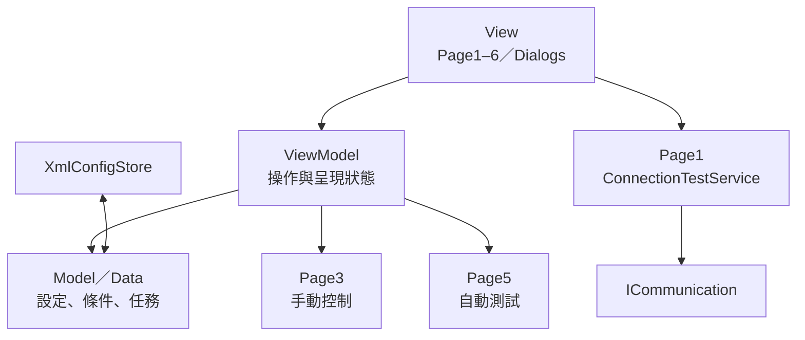
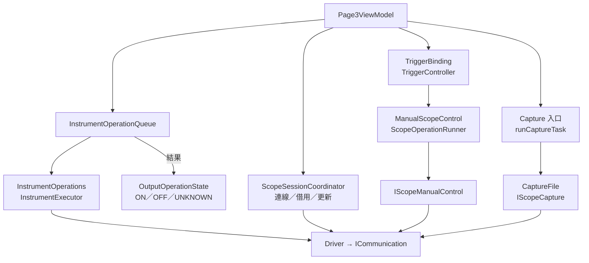
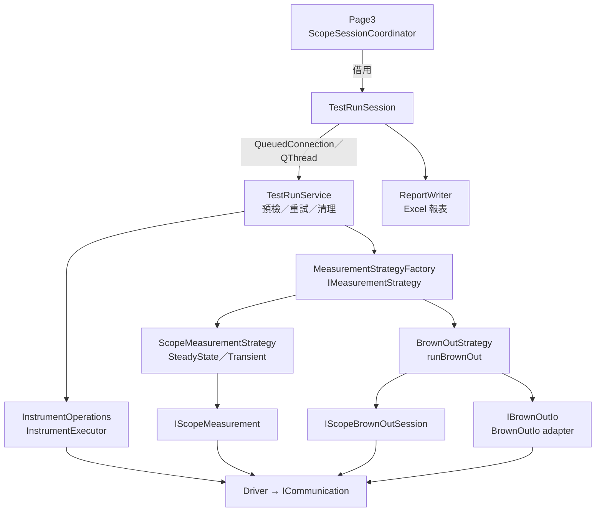

# 整體架構

本頁呈現完整架構與分層職責。執行流程見 [Page3：手動控制流程](PAGE3_FLOW.md) 與 [Page5：自動測試流程](PAGE5_FLOW.md)。

## 跨頁接線與互鎖

### 初始化接線

```text
MainWindowViewModel 建構
  → initializeViewModels()：建立 Page1～6 ViewModel
  → setupPageConnections()
      ├─ PageConnectionCoordinator::setupPageConnections()
      │    ├─ Page1 → Page2／3／5：儀器配置與相關數量更新
      │    ├─ Page2 → Page3／5：條件更新
      │    ├─ Page5 → Page3：outputsUncertain → adoptUncertainOutputs
      │    └─ 注入 provider：條件、示波器借用、Load Sync、輸出恢復檢查
      ├─ 建立互鎖連線
      │    ├─ Page3ViewModel::controlActiveChanged ──┐
      │    ├─ Page4ViewModel::controlActiveChanged ──┼→ updateControlPermissions()
      │    └─ Page5ViewModel::runningChanged ────────┘
      └─ updateControlPermissions()：執行一次初始判斷
```

接線完成後，來源 signal 直接觸發目標 slot；Coordinator 不逐次轉送通知。

Page6 使用獨立的 `Page6ViewModel`，不加入 Page1–5 的儀器接線或 XML 契約。既有控制頁互鎖保留，Page6 不持有儀器連線或 lease。

### Page6：圖片辨識與匯出

```text
Page6 → Page6ViewModel
  → scanImages()：背景遞迴掃描與自然排序
  → OllamaClient：本機非同步 HTTP，逐張辨識、逾時與中止
  → parseText()：JSON／轉錄文字／具明確欄名的量測表格
  → OcrResultsModel：唯讀通道／數值、單位、缺值與核對狀態
  → exportExcel()：背景建立多工作表 XLSX，名稱碰撞時保留全部資料
```

`WaveformOcr::Row` 是純資料；原始回覆與原值保留。辨識欄位在 View 與 Model 均禁止編輯，使用者只能變更核對勾選，不提供新增通道。`std::optional<double>` 表示有效數值，缺值不當成零。文字表格只從明確的 Value／Current 欄讀取量測，不以統計 Mean／Min／Max 欄替代其他量測種類。View 固定使用 `http://127.0.0.1:11434`，不顯示位址輸入；ViewModel／Client 仍接受本機端點，供離線測試使用。

掃描與匯出透過 `QtConcurrent::run`、`QFutureWatcher` 回到 ViewModel，背景工作只持有資料快照與共用原子取消旗標。Ollama 使用 `QNetworkAccessManager` 所屬事件迴圈；停止後的舊回覆不提交結果。關閉主視窗時，先完成既有儀器／Page5 收尾，再中止 Page6 並等待背景工作結束。Page6 的 Excel writer 與 Page5 報表獨立，只共用 ZIP 儲存工具。

### 執行期間的互鎖

```text
Page5 開始 Run → runningChanged(true)
  → MainWindowViewModel::updateControlPermissions()
  → Page3、Page4：setControlAllowed(false)
  → controlStateChanged
  → MainWindow::updateControlPageLock()：更新畫面鎖定

Page5 結束 Run → runningChanged(false)
  → updateControlPermissions()
  → 依目前各頁狀態重新判斷操作權限
  → controlStateChanged → 更新畫面
```

| 頁面 | `setControlAllowed(true)` 的條件 |
| --- | --- |
| Page3 | Page4 無控制活動，且 Page5 未執行 Run。 |
| Page4 | Page3 無控制活動、Page5 未執行 Run，且示波器配置不在更新中。 |
| Page5 | Page3、Page4 均無控制活動，且示波器配置不在更新中。 |

Page3 的控制活動包含 ON／UNKNOWN 輸出。這裡的互鎖管理頁面操作權限，不是 QMutex 執行緒鎖。通訊失敗而需回 Page1 修正時，依 [輸出恢復流程](PAGE3_FLOW.md#通訊異常恢復) 解除。

來源：[接線初始化與權限判斷](src/viewmodels/mainwindow/mainwindowviewmodel.cpp)、[跨頁資料與 provider 接線](src/viewmodels/mainwindow/pageconnectioncoordinator.cpp)、[畫面鎖定](src/views/mainwindow/mainwindow.cpp)。

## 整體流程

介面採 MVVM；下圖表示主要資料與執行路徑，實際硬體依賴由 MainWindow 與工廠組裝後注入。

### 頁面與資料



### Page3：控制與示波器



### Page5：執行與量測



| Page5 輔助操作 | 路徑 |
| --- | --- |
| 穩態啟動 | prepareSteadyAcquisition → Driver |
| Auto Period | IScopeAutoPeriod → IScopePeriodSession → Driver |
| Write Oscilloscope | IScopeConfiguration → Driver |
| Page5 策略波形保存 | 每筆完成的擷取 → StrategyWaveformCapture → CaptureFile → IScopeCapture → Driver |

四種暫態內部分為共用搜尋 `DirectionSearch`、各自的 `Event` 與整次執行共用的 `Execution`。搜尋狀態按方向建立，短路保護跨 Level／Trial 保留；事件僅透過既有能力介面與操作回呼執行。程式入口與閱讀順序見 [暫態：共用搜尋與事件流程](PAGE5_FLOW.md#暫態共用搜尋與事件流程)。

Static／Dynamic 由 `executeSteadyTest()` 串接供電／負載準備、示波器準備、共用策略與輸出清理；`SteadyDetail::Search` 再分開參考擷取、方向搜尋、結果累積及 Scope STOP。兩種負載沿用相同搜尋，分工與閱讀順序見 [Static／Dynamic 量測](PAGE5_FLOW.md#3-staticdynamic-量測)。

跨頁操作權限與畫面鎖定見 [互鎖流程](#跨頁接線與互鎖)。

## 分層職責

| 層級 | 職責 | 目錄 |
| --- | --- | --- |
| View | 頁面、對話框、使用者事件與依賴組裝 | `src/views` |
| ViewModel | 操作入口、呈現狀態與 Qt 表格資料映射 | `src/viewmodels` |
| Model / Data | 設定、條件、任務與結果資料 | `src/models`、`src/data` |
| Service | 測試執行、策略、儀器操作、Capture 與 XML | `src/service` |
| Infrastructure | 背景作業、執行緒生命週期、報表排程與儲存 | `src/infrastructure` |
| Hardware | 儀器驅動、通訊與硬體資源管理 | `src/hardware` |
| 共用 UI | 樣式、表格工具與 Page3 觸發控制器 | `src/ui` |

## 操作流程

操作流程：**Page1 設定儀器 → Page2 建立條件 → Page3 手動確認，或 Page5 編排並執行測試**。Page4 為獨立通訊指令工具。

[返回文件導覽](README.md#文件導覽)
