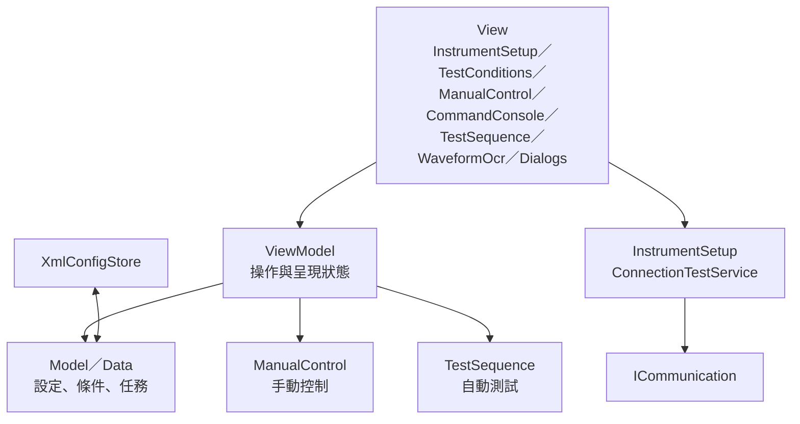
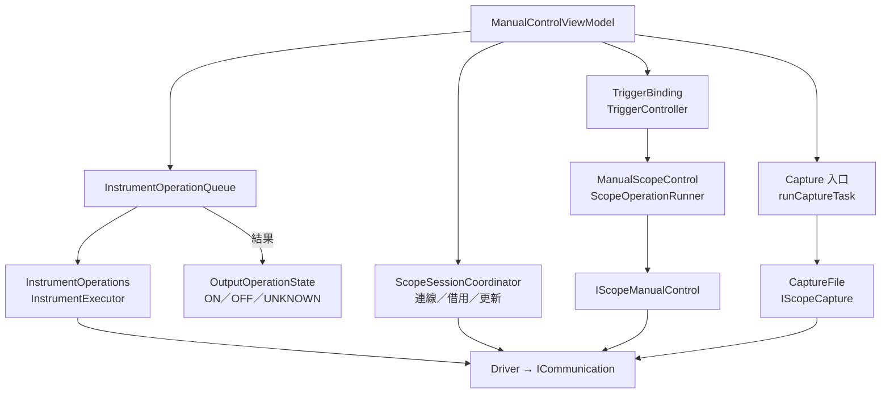
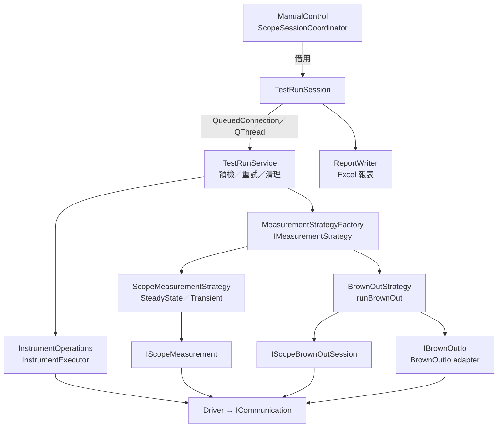

# 整體架構

本頁呈現完整架構與分層職責。執行流程見 [ManualControl：手動控制流程](MANUAL_CONTROL_FLOW.md) 與 [TestSequence：自動測試流程](TEST_SEQUENCE_FLOW.md)。

## 功能命名

頁面依功能命名，不以頁籤位置識別。View 使用 `Page` 後綴，ViewModel／Model 使用各自的層級後綴；檔名與功能目錄沿用專案的小寫慣例。

| 功能 | View | 功能目錄 | XML 區段 |
| --- | --- | --- | --- |
| 儀器設定 | `InstrumentSetupPage` | `instrumentsetup` | `InstrumentSetup` |
| 測試條件 | `TestConditionsPage` | `testconditions` | `TestConditions` |
| 手動控制 | `ManualControlPage` | `manualcontrol` | `ManualControl` |
| 指令工具 | `CommandConsolePage` | `commandconsole` | `CommandConsole` |
| 自動測試 | `TestSequencePage` | `testsequence` | `TestSequence` |
| 波形辨識 | `WaveformOcrPage` | `waveformocr` | 不納入設定 XML |

`InstrumentSetupConfig` 保存整體儀器設定，`InstrumentConfig` 保存單台儀器。頁籤顯示文字與順序保持原有設計。XML 只接受上述五個完整功能區段，不讀取或轉換舊版數字頁碼標籤；載入驗證失敗不套用部分設定。

## 跨頁接線與互鎖

### 初始化接線

```text
MainWindowViewModel 建構
  → initializeViewModels()：建立六個功能 ViewModel
  → setupPageConnections()
      ├─ PageConnectionCoordinator::setupPageConnections()
      │    ├─ InstrumentSetup → TestConditions／ManualControl／TestSequence：儀器配置與相關數量更新
      │    ├─ TestConditions → ManualControl／TestSequence：條件更新
      │    ├─ TestSequence → ManualControl：outputsUncertain → adoptUncertainOutputs
      │    └─ 注入 provider：條件、示波器借用、Load Sync、輸出恢復檢查
      ├─ 建立互鎖連線
      │    ├─ ManualControlViewModel::controlActiveChanged ──┐
      │    ├─ CommandConsoleViewModel::controlActiveChanged ──┼→ updateControlPermissions()
      │    └─ TestSequenceViewModel::runningChanged ────────┘
      └─ updateControlPermissions()：執行一次初始判斷
```

接線完成後，來源 signal 直接觸發目標 slot；Coordinator 不逐次轉送通知。

WaveformOcr 使用獨立的 `WaveformOcrViewModel`，不加入 InstrumentSetup／TestConditions／ManualControl／CommandConsole／TestSequence 的儀器接線或 XML 契約。既有控制頁互鎖保留，WaveformOcr 不持有儀器連線或 lease。

### WaveformOcr：圖片辨識與匯出

```text
WaveformOcr → WaveformOcrViewModel
  → scanImages()：背景遞迴掃描與自然排序
  → OllamaClient：本機非同步 HTTP，逐張辨識、逾時與中止
  → parseText()：JSON／轉錄文字／具明確欄名的量測表格
  → OcrResultsModel：可編輯數值與選填資訊、單位、缺值與核對狀態
  → exportExcel()：背景建立多工作表 XLSX，名稱碰撞時保留全部資料
```

`WaveformOcr::Row` 是 Model 層的純資料；`OcrResultsModel` 是 ViewModel 層的 Qt 表格介面，持有結果並處理編輯、單位驗證與顯示角色，因此不另設僅轉存相同資料的 WaveformOcrModel。View 只綁定表格、呈現 ViewModel 提供的選取內容及處理對話框、圖片縮放，不直接呼叫 parser、HTTP 或 Excel writer。預設模型、本機端點 `http://127.0.0.1:11434`、匯出命名由 ViewModel 管理；測試可傳入其他本機端點。

使用者可修改 Max／Min／RMS／Mean 與選填的通道、統計範圍。實際數值修改會清除舊核對勾選，保留原始回覆、原值與原始錯誤；未改變數值的編輯不會弄髒資料或取消核對。`resultEdited` 與單純的 `dataChanged` 顯示更新分開，鎖定表格不算編輯。`std::optional<double>` 表示有效數值，缺值不當成零，無法解析的輸入保留供修正且不匯出為數字。

解析器接受 JSON、量測卡片的跨行文字與明確欄名的表格。`Meas 3 2` 表示第 3 個量測、來源 CH2；來源不明時不沿用前一個通道。不同通道或統計範圍分列；同欄重複且相同的值可去重，衝突值保留為待修正項目。表格只從 Value／Current 欄讀取量測，不以統計 Mean／Min／Max 欄替代其他量測種類。通道與範圍缺漏不再阻擋有效數值與匯出。

掃描與匯出透過 `QtConcurrent::run`、`QFutureWatcher` 回到 ViewModel，背景工作只持有資料快照與共用原子取消旗標。Ollama 使用 `QNetworkAccessManager` 所屬事件迴圈；停止後的舊回覆不提交結果。關閉主視窗時，先停止 TestSequence、完成輸出安全門檻，再中止 WaveformOcr 並等待背景工作結束；有未匯出資料則提供匯出／放棄／取消，確認後才提交 TestSequence shutdown。取消或匯出失敗保留資料與仍需維持的互鎖。WaveformOcr 的 Excel writer 與 TestSequence 報表獨立，只共用 ZIP 儲存工具。

每次批次／模型查詢與停止均更新執行識別碼，發出可重入訊號後與排程下一張前再次檢查，避免停止或重新啟動後送出舊請求。匯出使用結果所屬資料夾作預設位置，取消新資料夾掃描不會改變舊結果的匯出位置。`CheckArchitecture.cmake` 禁止 WaveformOcr View 直接依賴 Data／Model／Service／Infrastructure／Hardware，並檢查非 UI 層、目標依賴及循環；離線回歸測試保留於本機。

### 執行期間的互鎖

```text
TestSequence 開始 Run → runningChanged(true)
  → MainWindowViewModel::updateControlPermissions()
  → ManualControl、CommandConsole：setControlAllowed(false)
  → controlStateChanged
  → MainWindow::updateControlPageLock()：更新畫面鎖定

TestSequence 結束 Run → runningChanged(false)
  → updateControlPermissions()
  → 依目前各頁狀態重新判斷操作權限
  → controlStateChanged → 更新畫面
```

| 頁面 | `setControlAllowed(true)` 的條件 |
| --- | --- |
| ManualControl | CommandConsole 無控制活動，且 TestSequence 未執行 Run。 |
| CommandConsole | ManualControl 無控制活動、TestSequence 未執行 Run，且示波器配置不在更新中。 |
| TestSequence | ManualControl、CommandConsole 均無控制活動，且示波器配置不在更新中。 |

ManualControl 的控制活動包含 ON／UNKNOWN 輸出。這裡的互鎖管理頁面操作權限，不是 QMutex 執行緒鎖。通訊失敗而需回 InstrumentSetup 修正時，依 [輸出恢復流程](MANUAL_CONTROL_FLOW.md#通訊異常恢復) 解除。

來源：[接線初始化與權限判斷](src/viewmodels/mainwindow/mainwindowviewmodel.cpp)、[跨頁資料與 provider 接線](src/viewmodels/mainwindow/pageconnectioncoordinator.cpp)、[畫面鎖定](src/views/mainwindow/mainwindow.cpp)。

## 整體流程

介面採 MVVM；下圖表示主要資料與執行路徑，實際硬體依賴由 MainWindow 與工廠組裝後注入。

### 頁面與資料



### ManualControl：控制與示波器



### TestSequence：執行與量測



| TestSequence 輔助操作 | 路徑 |
| --- | --- |
| 穩態啟動 | prepareSteadyAcquisition → Driver |
| Auto Period | IScopeAutoPeriod → IScopePeriodSession → Driver |
| Write Oscilloscope | IScopeConfiguration → Driver |
| TestSequence 策略波形保存 | 每筆完成的擷取 → StrategyWaveformCapture → CaptureFile → IScopeCapture → Driver |

四種暫態內部分為共用搜尋 `DirectionSearch`、各自的 `Event` 與整次執行共用的 `Execution`。搜尋狀態按方向建立，短路保護跨 Level／Trial 保留；事件僅透過既有能力介面與操作回呼執行。程式入口與閱讀順序見 [暫態：共用搜尋與事件流程](TEST_SEQUENCE_FLOW.md#暫態共用搜尋與事件流程)。

Static／Dynamic 由 `executeSteadyTest()` 串接供電／負載準備、示波器準備、共用策略與輸出清理；`SteadyDetail::Search` 再分開參考擷取、方向搜尋、結果累積及 Scope STOP。兩種負載沿用相同搜尋，分工與閱讀順序見 [Static／Dynamic 量測](TEST_SEQUENCE_FLOW.md#3-staticdynamic-量測)。

跨頁操作權限與畫面鎖定見 [互鎖流程](#跨頁接線與互鎖)。

## 分層職責

| 層級 | 職責 | 目錄 |
| --- | --- | --- |
| View | 頁面、對話框、使用者事件與依賴組裝 | `src/views` |
| ViewModel | 操作入口、呈現狀態與 Qt 表格資料映射 | `src/viewmodels` |
| Model / Data | 設定、條件、任務與結果資料 | `src/models`、`src/data` |
| Service | 測試執行、策略、儀器操作、Capture 與 XML | `src/service` |
| Infrastructure | 背景作業、執行緒生命週期、報表排程與儲存 | `src/infrastructure` |
| Hardware | 儀器驅動、通訊與硬體資源管理 | `src/hardware` |
| 共用 UI | 樣式、表格工具與 ManualControl 觸發控制器 | `src/ui` |

## 操作流程

操作流程：**InstrumentSetup 設定儀器 → TestConditions 建立條件 → ManualControl 手動確認，或 TestSequence 編排並執行測試**。CommandConsole 為獨立通訊指令工具。

[返回文件導覽](README.md#文件導覽)
