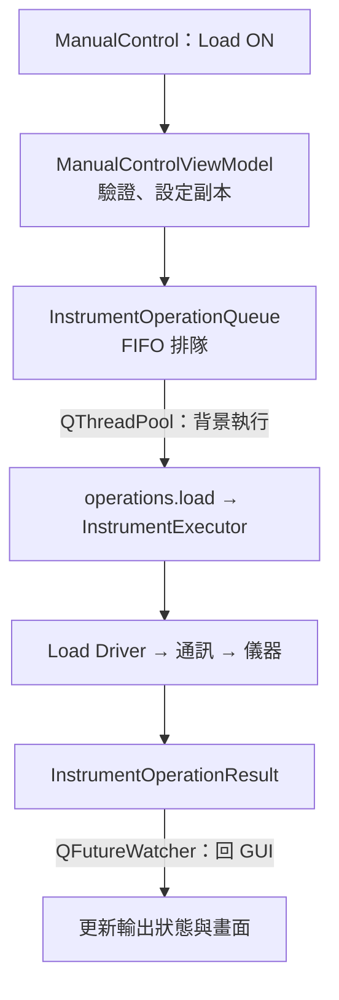

# ManualControl：手動控制流程

跨頁連動與操作互鎖見 [接線流程](ARCHITECTURE.md#跨頁接線與互鎖)。

## 1. 手動控制

以 Load ON 為例：



```text
【GUI】
onLoadToggled()
  → handleLoad()
  → startInstrumentOperation()
  → OutputOperationState::begin()
  → InstrumentOperationQueue::submit()
  → runInstrumentOperation()

【QThreadPool 背景工作】
operations.load(...)
  → InstrumentExecutor::runLoad(...)
  → 先讀取各通道輸出狀態，全部有有效回應後才設定／ON
  → Driver → ICommunication → 儀器
  → QPromise 寫入結果並完成

【回 GUI】
QFutureWatcher::finished
  → 完成 callback
  → OutputOperationState::complete()
  → 更新 ON／OFF／UNKNOWN，解除忙碌狀態
```

來源：[ManualControlViewModel](src/viewmodels/manualcontrol/manualcontrolviewmodel.cpp)、[Queue](src/service/operations/instrumentoperationqueue.h)、[runner](src/infrastructure/execution/instrumentoperationrunner.cpp)。

### 通訊異常恢復

```text
ON／Change：開啟通訊 → 讀取設備狀態 → 設定／控制 → 回報
  └─ 開啟或讀取失敗，尚未改變輸出
       → 保留原狀態；原本全部 OFF 則可回 InstrumentSetup 修正 COM／位址

輸出仍為 ON／UNKNOWN → 保留跨頁互鎖
  → ManualControl 重試 OFF
      ├─ 全部確認 OFF → 解除互鎖
      └─ OFF 失敗 → 保留 ON／UNKNOWN
```

Relay 先讀取每個映射通道；AC、DC 與 Load 先查詢輸出狀態。開啟 COM 成功不代表設備有回應。OFF 直接嘗試清理，不受前置查詢失敗阻擋；清理使用原設定，短路保護仍依 Input OFF、放電、解除短路順序完成。

## 2. 各操作的底層接線

```text
AC Input     → operations.input   → InstrumentExecutor::runInput()
Relay        → operations.relay   → InstrumentExecutor::runRelay()
Load         → operations.load    → InstrumentExecutor::runLoad()
Dynamic Load → operations.dynamic → InstrumentExecutor::runDynamicLoad()
單台 DC      → operations.dcInput → runDcInput()
群組 DC      → operations.dcGroup → runDcGroup()

AC／Relay／Load／Dynamic → startInstrumentOperation() → 操作佇列
DC                      → handleDcOperation()        → 同一操作佇列
```

來源：[ManualControl 工廠](src/viewmodels/manualcontrol/manualcontrolviewmodel_factory.cpp)。

## 3. 示波器連線更新

```text
InstrumentSetupViewModel::configUpdated
  → ManualControlViewModel::onInstrumentSetupConfigChanged()
  → ScopeSessionCoordinator::queueConfiguration()
  → 等待現有借用釋放，安排背景更新
  → OscilloscopeManager::buildFromConfig()
  → 建立通訊與 Driver → connect()
  → 保存成功連線的示波器 → 更新控制狀態
```

來源：[跨頁接線](src/viewmodels/mainwindow/pageconnectioncoordinator.cpp)、[ScopeSessionCoordinator](src/service/oscilloscope/scopesessioncoordinator.cpp)。

## 4. 示波器手動控制與擷取

```text
手動按鈕／輪詢
  → MSOSeries456TriggerController（實作 ITriggerController）
  → ManualScopeControl
  → 取得 lease → ScopeOperationRunner 背景執行
  → IScopeManualControl → MSOSeries456 Driver
  → 完成通知回 GUI

保存 PNG／CSV／WFM
  → ManualControlViewModel::executeCapture()：檢查操作權與忙碌狀態
  → 單通道 CSV／WFM：executeWaveformCapture(context, format)
    PNG／多通道 CSV／WFM：對應 CaptureCommand
  → 保留示波器與 CaptureLease → runCaptureTask()
  → CaptureFile／IScopeCapture → MSOSeries456 Driver
  → 保存檔案，完成後釋放借用
```

來源：[單通道 Capture](src/service/capture/waveformcaptureworkflow.cpp)、[ManualScopeControl](src/service/oscilloscope/manualscopecontrol.cpp)、[Capture runner](src/service/capture/capturetaskrunner.cpp)。

## 5. 提供示波器給 TestSequence

```text
TestSequence：scopeProvider()
  → ManualControlViewModel::borrowOscilloscope()
  → ScopeSessionCoordinator::borrowForTest()
      ├─ 未連線／忙碌／等待設定更新 → 借用失敗
      └─ 可用 → 同一個 scope 的 shared_ptr ＋ 測試 lease
           → TestSequence／TestRunSession 保留借用
           → 背景 TestRunService 使用 context.scope

Run 與報表工作結束
  → TestSequence／Session 釋放借用
  → 最後一個 lease 結束
  → 依狀態恢復控制、處理待更新配置
```

後續流程：[TestSequence：自動測試流程](TEST_SEQUENCE_FLOW.md)。

[返回文件導覽](README.md#文件導覽)
