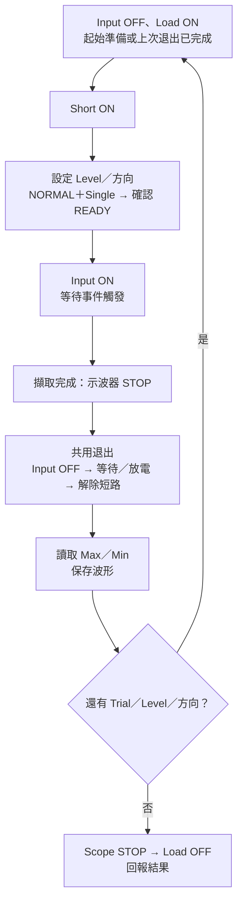
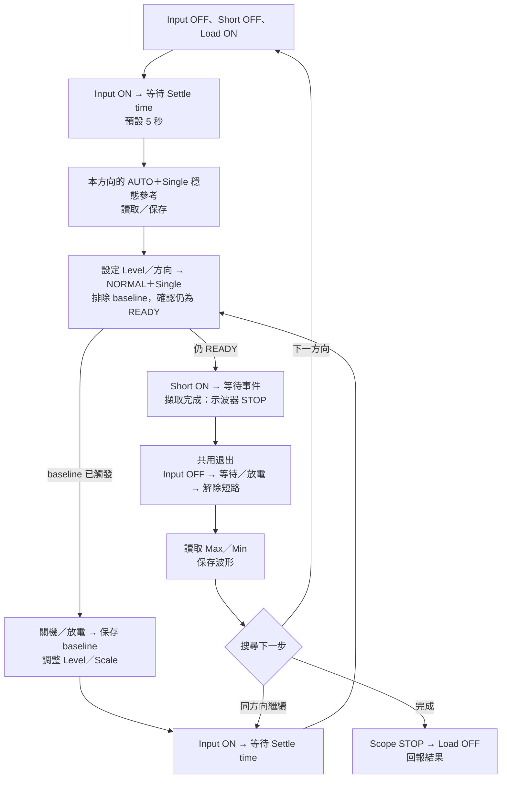
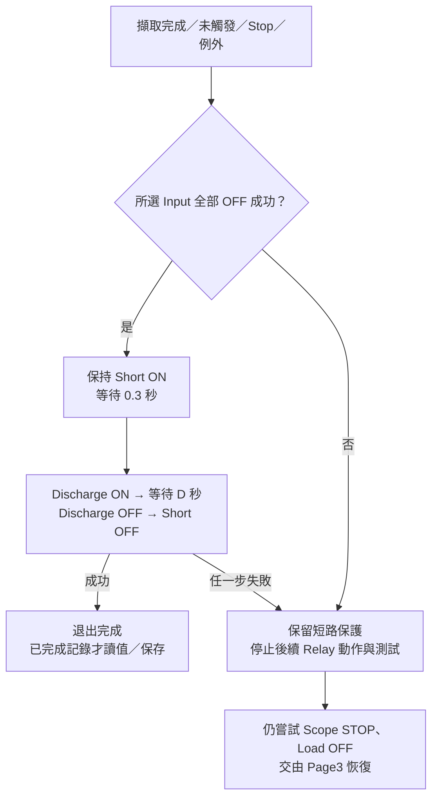
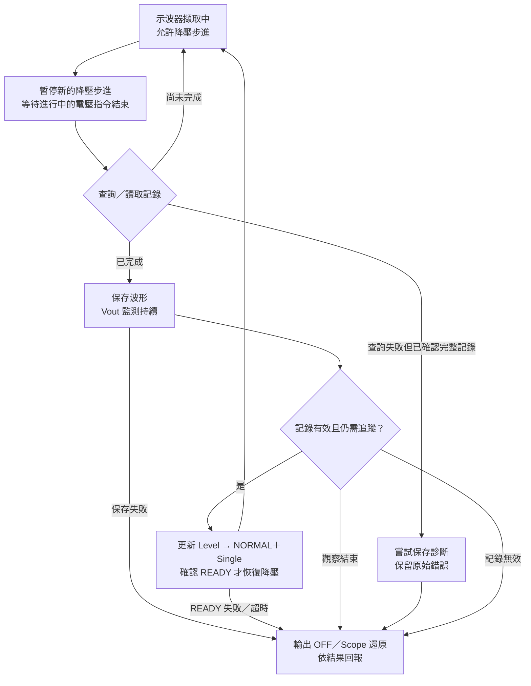

# Page5：量測策略

本頁說明各測試的事件順序、波形搜尋與結果語意。程式如何呼叫這些策略，見 [Page5：自動測試流程](PAGE5_FLOW.md)；型號與使用條件見 [支援儀器與限制](SUPPORTED_INSTRUMENTS.md)。

一般量測與 Brown Out 共用 `IMeasurementStrategy` 執行介面，再依測試方式分工。以下為一般量測的五類策略，Static／Dynamic 合併為一類，提供 Search direction：BOTH／Rise／Fall。BOTH 分別搜尋兩個方向，單邊模式未選的極值顯示 NA。四種暫態及其 Group 只保留 Max／Min；Static／Dynamic 與 Brown Out 保留 RMS／Mean。

「單組測試」指測試一筆負載條件。示波器的 AUTO／NORMAL 是觸發模式，Single 是完成一次擷取後停止，以下以 **AUTO＋Single**、**NORMAL＋Single** 標示。

## 一般量測策略

### 1. Static／Dynamic

Load OFF → Input OFF → 關機等待 → 在 OFF 狀態設定條件 → Input ON → 開機等待 → 靜態／動態 Load ON → 負載穩定等待 → 示波器 Trigger AUTO。Capture 開啟時準備階段保持 STOP，由後續 AUTO＋Single／NORMAL＋Single 啟動各階段擷取；未開啟時允許準備階段連續 RUN。

接著執行 Auto Period（在各筆 Static／Dynamic 設定中勾選，預設關閉）：自動調整時間軸，目標顯示 **5 個週期**，重新擷取確認為 **3～8 個週期**即接受；未啟用則沿用目前時基。Write Oscilloscope 僅設定初始時基，不控制此開關。

量測完成後 Scope STOP → Load OFF → Input OFF，清理成功才回報成功。Group 每筆也相同；三段等待的設定見 [Static／Dynamic 流程](PAGE5_FLOW.md#3-staticdynamic-量測)。

搜尋時以 AUTO＋Single 擷取新的穩態參考 → 切換 NORMAL＋Single → 分別進行 Rise／Fall 搜尋；每輪重新擷取一次並調整 Level，無觸發時 STOP，結束該方向搜尋。

### 2. Turn on

關機 → 放電 → 解除放電 → NORMAL＋Single 待命 → 開機 → 等待觸發並量測。

每次試驗重做完整開機流程，以不同 Level 搜尋事件邊界。

### 3. Turn off

開機穩定 → AUTO＋Single 穩態參考 → 調整 Level 排除穩態觸發 → NORMAL＋Single 保持待命 → 關機等觸發。

依結果更新 Level，重新開機穩定後重試。

### 4. Turn on then short

開機穩定 → AUTO＋Single 穩態參考 → 調整 Level 排除穩態觸發 → NORMAL＋Single 保持待命 → 短路等觸發。

事件擷取完成（示波器 STOP）→ 確認 Input OFF → 關機等待 → 保持短路並放電 → 解除放電 → 解除短路 → 讀取量測／保存 Capture。下一輪重新開機穩定、NORMAL＋Single 待命後再施加短路。

### 5. Short then turn on

確認 Input OFF → 關機等待／放電 → 解除放電 → 短路 → NORMAL＋Single 待命 → 開機 → 等待觸發。

事件擷取完成（示波器 STOP）後，使用相同的短路退出流程，再讀取量測／保存 Capture。每次試驗重做完整流程，再測下一個 Level。

兩種短路測試（含 Group）在無觸發、Stop、例外及最後結束時也執行退出流程。**任一 Input OFF 失敗，不釋放短路 Relay、不開始傳檔，也不自動重試或執行後續條件。** 放電 ON／OFF 失敗同樣不繼續解除短路；Scope STOP、Load OFF 仍會嘗試。錯誤狀態與當次設定交給 Page3。

關機等待為 300 ms，放電時間使用該任務的 `Discharge time`；這些等待不是 DUT 殘壓量測，仍須按治具與 DUT 驗證。

兩種 Short 的單組、Group 流程圖與時間軸，見 [Short 測試流程與時間](#short-測試流程與時間)。

### 量測方式

- BOTH 的每筆有效波形均累積 Max、Min；Rise／Fall 只決定觸發方向與門檻推進。四種暫態只量測 Max／Min；Static／Dynamic 的 RMS／Mean 使用最後一筆有效量測，並非跨次平均。單邊模式未選的極值顯示 NA。
- Static／Dynamic 先量穩態，再調整觸發門檻；四種暫態則重複開關機或短路，逐步縮小搜尋範圍。
- 波形超出垂直量程時，自動放大刻度後重測；任一量測欄位查詢通訊失敗或搜尋超過限制，均回報失敗。合法 NA 仍依原量測規則處理。

暫態在 READY 前自行觸發並完成時，保存診斷波形後回報失敗；未完成的不保存。Capture 須已啟用，Short 仍先完成 Input OFF／放電／解除短路。

### 沒有觸發時

| 策略 | 處理方式 |
| --- | --- |
| Static／Dynamic | 保留已量到的穩態與搜尋結果。 |
| Turn on／Short then turn on | 保留另一側的有效事件；兩側都沒有事件則回報失敗（NA）。 |
| Turn off／Turn on then short | 搜尋正常結束後，將穩態值與事件值合併，保留較大 Max、較小 Min；沒有事件時使用穩態值。 |

### Page5 量測值的來源

**所有 Group 都逐負載保存及顯示各自的單組測試結果。** Static／Dynamic 保留 Max／Min／RMS／Mean，四種暫態只保留 Max／Min。Pass 表示策略與清理按目前規則完成，沒有另以量測值比對 DUT 規格上下限，也不保證每欄都有有效數字。

| 策略 | 最後顯示的 Max／Min | RMS／Mean | 來源是否同一張波形？ |
| --- | --- | --- | --- |
| Static／Dynamic | AUTO＋Single 參考與 NORMAL＋Single 有效搜尋波形的最大 Max／最小 Min。 | 最後有效 NORMAL＋Single 搜尋記錄；若無後續事件，保留 AUTO＋Single 參考值。 | 可來自不同波形。 |
| Turn on／Short then turn on | 所有有效事件的最大 Max／最小 Min。 | 不量測、不顯示。 | Max／Min 可來自不同波形。 |
| Turn off／Turn on then short | 有效事件與穩態參考合併後的極值；baseline 排除。 | 不量測、不顯示。 | Max／Min 可來自不同波形。 |
| 四種暫態 Group | 每個 Load 各自保存 Max／Min，不跨負載合併。 | 不量測、不顯示。 | 同一列屬於同一 Load；Max／Min 仍可能來自該 Load 的不同波形。 |
| Static／Dynamic Group | 每個 Load 各自保存 Max／Min，不跨負載合併。 | 每個 Load 各自保存自己的 RMS／Mean，規則與單組測試相同。 | 同一列屬於同一 Load；四值仍可能來自該 Load 的不同波形。 |
| Brown Out Fixed Fall | 第一筆有效降壓事件的 Max／Min，穩態參考不合併。 | 同一筆事件。 | 同一筆有效事件記錄。 |
| Brown Out Track Level | 所有接受的有效事件的最大 Max／最小 Min。 | 最後接受的有效事件。 | 可來自不同波形。 |

以同一負載條件的 Static／Dynamic 為例，三筆有效波形為：

| 波形 | Max | Min | RMS | Mean |
| --- | ---: | ---: | ---: | ---: |
| 第 1 筆 | 12 | 2 | 6 | 5 |
| 第 2 筆 | 10 | -1 | 4 | 3 |
| 第 3 筆 | 11 | 0 | 5 | 4 |
| Page5 彙總 | **12（第 1 筆）** | **-1（第 2 筆）** | **5（第 3 筆）** | **4（第 3 筆）** |

Static／Dynamic Group 的 Page5 結果與 Excel 逐負載、逐通道列出四值，例如：

| 負載條件 | 通道 | Max | Min | RMS | Mean | 狀態 |
| --- | --- | ---: | ---: | ---: | ---: | --- |
| Load row 1：100% | CH1 | 12 | -1 | 5 | 4 | Pass |
| Load row 2：50% | CH1 | 11 | -2 | 4 | 3 | Pass |
| Load row 3：10% | CH1 | 10 | -3 | 3 | 2 | Pass |

Group 總列只保留完成數、狀態及說明，不再產生混合數值。失敗／取消成員保留已取得資料及狀態，後續條件標示 Skipped；沒有資料就顯示 NA，不借用前一個負載的值。重試保留各次執行紀錄。

Turn on、Turn off、Short then turn on、Turn on then short 的 Group 也採相同分列方式，但每個負載只顯示 Max／Min，例如：

| 負載條件 | 通道 | Max | Min | 狀態 |
| --- | --- | ---: | ---: | --- |
| Load row 1：100% | CH1 | 12 | -1 | Pass |
| Load row 2：50% | CH1 | 11 | -2 | Pass |
| Load row 3：10% | CH1 | 10 | -3 | Pass |

一般策略在完成擷取後讀值，更新該負載的結果；單邊 Rise／Fall 將未選的極值顯示 NA。**目前沒有保存每次 trigger 的完整數值歷史表。** 各策略尚未記錄極值來自哪張 Capture。

四種暫態的事件、AUTO＋Single 參考、baseline 及 Capture 路徑均不查詢 RMS／Mean。Excel 與其他策略共用欄位，暫態的單組、Group 摘要及成員列在 RMS／Mean 欄留空；Page5 與暫態量測日誌只呈現 Max／Min。

Capture 開啟時，每筆完成記錄另保存勾選的 PNG／CSV／WFM，包含參考、baseline 與截幅診斷。CSV 是波形資料，不是逐次四值統計表；PNG 不額外產生 JSON。

Brown Out Track 未開 Capture 時使用 NORMAL＋連續 RUN；開啟後改為逐筆 NORMAL＋Single，讀取／保存期間暫停降壓，重新 arm 並確認 READY 後繼續。

來源：[一般搜尋](src/service/oscilloscopestrategy/steadystatesearchstrategy.cpp)、[暫態共用搜尋](src/service/oscilloscopestrategy/transientsearch.cpp)、[四種事件與清理入口](PAGE5_FLOW.md#暫態共用搜尋與事件流程)、[Group 逐負載執行與結果](src/service/testrun/testrunmeasurement.cpp)、[Brown Out](src/service/brownout/brownoutrunner.cpp)、[Capture 保存](src/service/capture/strategywaveformcapture.h)、[Page5 顯示](src/viewmodels/presentation/taskresultformatter.h)。

### 技術細節

#### 搜尋方式：穩態追蹤與暫態二元搜尋

**Static／Dynamic** 先以 AUTO＋Single 擷取穩態參考，再以 NORMAL＋Single 分別搜尋正／負緣。目前不是二元搜尋：步距使用 `觸發 CH Scale × 0.04`，正緣以 `max(Level + 步距, 本次 Max + 步距)` 更新門檻，負緣以 `min(Level − 步距, 本次 Min − 步距)` 更新，直到正常等待逾時、沒有觸發。

程式由 [SteadyDetail::Search](src/service/oscilloscopestrategy/steadysearch.cpp) 的 `captureReference()`、`searchDirection()`、`accumulateRecord()` 與 `finish()` 分別負責參考、搜尋、累積及結果清理。供電與負載的準備、最後 OFF 仍在 [Service 流程](PAGE5_FLOW.md#3-staticdynamic-量測)。

**四種暫態** 使用以下流程：

1. 在同一 Level 重複 `Trials per level` 次試驗；任一次事件觸發算 **HIT**，全部未觸發才算 **MISS**。
2. 只有 HIT 時，向外擴張門檻尋找 MISS；首次只有 MISS 時，向內尋找事件。因此一次 MISS 不代表整個搜尋結束。
3. 建立 HIT／MISS 邊界後，下一個 Level 取兩者中點：`(HIT Level + MISS Level) ÷ 2`。
4. 反覆縮小區間，直到寬度不超過 `Search tolerance`。若新波形出現更大極值，會重新擴大搜尋邊界。

負緣使用相同概念，向較低的 Level 搜尋。Turn off／Turn on then short 會先排除穩態觸發，只有施加關機／短路之後的擷取才算事件。

**範例：** 已知 54 V 為 HIT、58 V 為 MISS，觸發 CH Scale 為 12.5 V/div，因此自動容差為 0.5 V：

| 試探 Level | 結果 | 更新後區間 |
| ---: | --- | --- |
| 56 V | MISS | 54～56 V |
| 55 V | HIT | 55～56 V |
| 55.5 V | HIT | 55.5～56 V，寬度 0.5 V，結束 |

以上假設事件可重現、峰值為 55.68 V，示範二分過程。最後回報的是波形實際量到的 Max，而非最後的 Level。

#### 步距公式與收斂容差

Static／Dynamic 與四種暫態均依觸發來源通道的垂直刻度換算步距：

```text
初始步距 = 觸發 CH Scale ÷ 25（正值）
暫態搜尋容差 = 觸發 CH Scale ÷ 25（正值）
```

## Short 測試流程與時間

兩種 Short 共用：**事件完成、示波器 STOP → Input OFF → 等待／放電 → 解除短路 → 讀值／保存波形 → 下一次事件。** Capture 啟用時才保存檔案。

### 1. 單組起始與搜尋

```text
整批預檢通過
  → 未選用但已配置的 Input OFF
  → 所選 Input OFF → 等待 0.3 秒
  → 保持 Short ON，放電 D 秒 → Discharge OFF → Short OFF
  → Input OFF 下設定本筆 Load → Load ON
  → 執行所選方向：Rise → Fall（單邊設定只跑該方向）
  → 各方向依 Level、Trials 重複對應事件流程
  → 確認退出完成 → Scope STOP → Load OFF → 回報結果
```

`Discharge time` 預設 D＝10 秒；每個 Level 的 `Trials per level` 預設 3 次，依觸發結果調整 Level。同一負載的事件之間 Load 保持 ON，整筆結束才 OFF。波形截幅時先保存診斷，再調整 Scale 重測。

### 2. Short then turn on：先短路，再開機



**短路 → NORMAL＋Single／READY → 開機 → 擷取完成 → 關機／放電／解除短路 → 保存。** 此模式不等待 Settle time；每次重新開機都在短路狀態下進行。

等待觸發預設上限 10 秒；未觸發也執行共用退出，該次為 MISS、不保存新波形。所選方向至少取得一筆有效事件，才能完成量測。

### 3. Turn on then short：先開機，再短路



**開機 → 穩定 → AUTO＋Single 穩態參考 → NORMAL＋Single 排除 baseline → READY → 短路 → 擷取完成 → 關機／放電／解除短路 → 保存。** 每個方向只在開始時取得參考；後續 Trial 重新開機、等待穩定後繼續。

施加短路前，先在 Input ON、Short OFF 下排除 baseline，預設等待 10 秒；仍 READY 才施加短路。baseline 不計入事件極值。事件未觸發也退出；搜尋正常結束後，合併有效事件與穩態參考的 Max／Min，無事件時使用穩態值。

程式中的 `waitForBaseline()` 對應施加短路前的背景觸發檢查，`waitForEvent()` 對應短路後的事件等待；兩者都不取代上電後的 Settle time。背景檢查若通訊失敗或擷取未完成，會中止並清理，不繼續施加短路。

### 4. 共用退出與時間



**Input OFF 成功 → 0.3 秒 → 保持短路並放電 D 秒 → 解除放電 → 解除短路 → 讀值／保存。** 完成的波形保持 STOP，退出成功後才傳檔。

D＝10 秒時，一次退出等待為 **10.3 秒**，另加設備操作與傳檔時間。Stop 或異常同樣先退出；Input OFF／放電失敗時保留短路保護，不執行後續 Group 或重試。事件已退出且沒有再次上電／短路，最後收尾不重複放電。

### 5. Group：逐負載重做單組


以 **100% → 50% → 10%** 為例，每個負載都完整執行「起始準備 → 單組搜尋 → 退出與 Load OFF」。前一筆成功才換下一筆；下一筆重新等待 0.3＋D 秒，成員之間沒有額外 Group 間隔。

Page5 與 Excel 逐負載、逐通道記錄 **Max／Min** 及狀態，不混合不同負載；失敗／取消保留已取得資料。Capture 序號在同次 Group 內接續。

## Brown Out（Dell/HP Test）

選擇 AC／DC Input、Load 及降壓來源 → 等待穩定 → 逐步降低指定來源的 Vin，另一種輸入維持供電 → 由負載讀回 Vout 確認關機，同時擷取示波器波形。

- **Fixed Fall (Vout)**：NORMAL＋Single，以指定輸出電壓通道與 Fall Level 擷取一次事件。
- **Track Level**：未開 Capture 時為 NORMAL＋連續 RUN，開啟時為逐筆 NORMAL＋Single；在一次降壓中隨有效波形調整 Level，累積 Max／Min，RMS／Mean 取最後一筆有效記錄。
- Step down 預設 0.5 V；Advanced 的 Ignore 預設勾選，使用內建等待與關機確認時間。

Brown Out 沿用示波器目前時基與水平位置，不提供 Auto Period。Track 開啟 Capture 後，在查詢／讀取記錄前暫停新的降壓步進，等正在執行的電壓指令結束，才讀取／保存。保存完成、更新 Level、重新啟動 NORMAL＋Single 並確認 READY 後才恢復降壓；Vout 監測與異常清理持續執行。



暫停時間不計入降壓步進間隔與進度期限，恢復後不補發一串降壓指令；READY 等待及傳輸仍各自有期限。Vout 關機確認／尾段觀察使用實際時間。讀取、保存、READY 或監測失敗，以及使用者 Stop，都停止後續降壓並清理。量測結果僅涵蓋成功讀回的有效波形。

[返回文件導覽](README.md#文件導覽)
