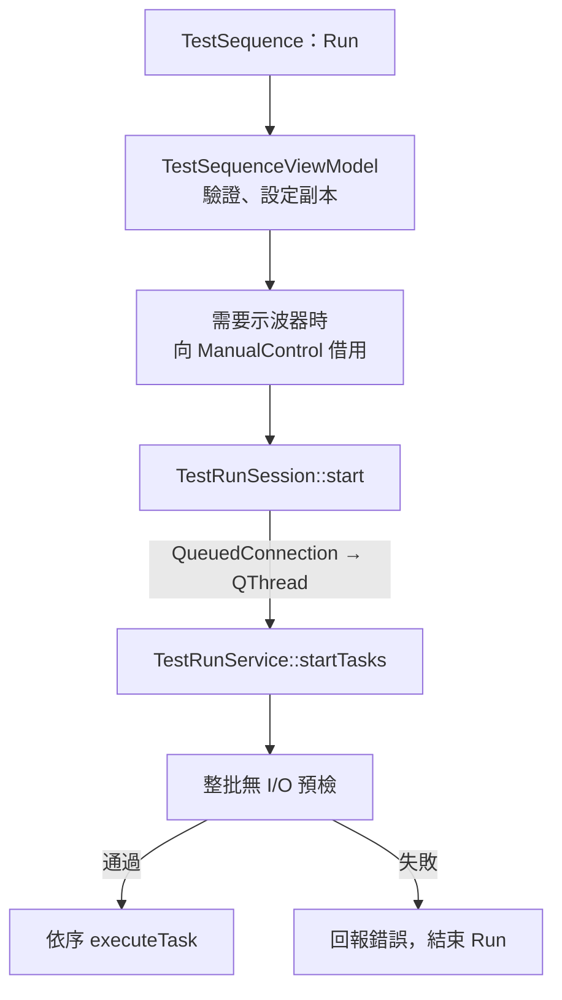

# TestSequence：自動測試流程

跨頁連動與操作互鎖見 [接線流程](ARCHITECTURE.md#跨頁接線與互鎖)。

## 1. Run 啟動



```text
【GUI】
TestSequence 畫面 → taskPayloads()
  → TestSequenceViewModel::startExecution()
  → 驗證任務／報表，取得設定副本
  → 需要時呼叫 scopeProvider()，借用 ManualControl 的示波器
  → TestRunSession::start()
  → QMetaObject::invokeMethod(..., Qt::QueuedConnection)

【背景 QThread】
TestRunService::startTasks()
  → 整批預檢（來源、負載、Relay ON 映射、短路／放電與 Group 條件）
  → 任務迴圈 → 重試迴圈 → executeTask()
  → 收尾清理
```

來源：[TestSequenceViewModel](src/viewmodels/testsequence/testsequenceviewmodel.cpp)、[TestRunSession](src/infrastructure/worker/testrunsession.cpp)、[TestRunService](src/service/testrun/testrunservice.cpp)。借用流程見 [ManualControl：手動控制流程](MANUAL_CONTROL_FLOW.md)。

## 2. 任務分派

```text
executeTask()
  ├─ Static／Dynamic
  │    → executeStaticTest()／executeDynamicTest() → executeSteadyTest()
  ├─ Turn on／Turn off／兩種短路測試
  │    → executeTransient() → 對應暫態策略 → runTransientStrategy()
  ├─ Turn off (descent)／Turn on then short (descent)
  │    → executeTransient() → DescentStrategy → 依序執行固定 Level／Trial
  ├─ Group
  │    → executeGroupTest() → 按條件順序執行對應單組流程
  ├─ Brown Out
  │    → executeBrownOut() → BrownOutStrategy → runBrownOut()
  └─ Relay／Write Oscilloscope／Delay
       → 對應輔助操作

單次失敗 → 依設定重試
Group 成員失敗／取消 → 停止該次 Group 後續條件
停止要求／清理失敗 → 中止後續任務與重試
```

來源：[任務分派](src/service/testrun/testrunservice.cpp)、[單組與 Group](src/service/testrun/testrunmeasurement.cpp)。

兩種短路測試的事件順序、每次退出與 Group 換筆等待，見 [Short 測試流程與時間](MEASUREMENT_STRATEGIES.md#short-測試流程與時間)。

所有 Group 都由 TestSequence Detail 與 Excel 逐負載、方向及通道呈現完整四值；Tasks 僅顯示摘要，不混合不同 Trial 的數值。結果顯示與 Excel 規則見 [量測值的來源](MEASUREMENT_STRATEGIES.md#testSequence-量測值的來源)。

### 暫態：共用搜尋與事件流程

四種暫態沿用同一入口與結果格式。搜尋器負責 Level、Trials 與極值；事件負責開關電、短路及等待的順序；整次執行共用的 `Execution` 保存停止檢查與短路保護狀態。

```text
runTransientStrategy()
  → 選擇 Event，建立 Execution
  → runSearch()
      → 確認通道／步距 → event.prepareRun() → Load ON
      → Max／Min 各自建立 DirectionSearch
          → 需要時 captureSteadyReference()
              → event.prepareReferenceInput() → AUTO 參考擷取
          → probe(Level)：重複 Trials
              → event.acquireTrial()：單次事件流程
              → 處理 Baseline／截幅／事件量測
          → 更新搜尋區間，直到收斂或沒有事件區間
      → 正常結束後合併穩態參考與事件極值
  → Execution::finish()：退出／清理、整理結果
```

| 閱讀入口 | 職責 |
| --- | --- |
| [transientstrategy.cpp](src/service/oscilloscopestrategy/transientstrategy.cpp) | 驗證、選擇事件、捕捉錯誤與明確收尾。 |
| [transientsearch.cpp](src/service/oscilloscopestrategy/transientsearch.cpp) | 共用搜尋、參考沿用、Baseline 排除與極值累積。 |
| [turnonevent.cpp](src/service/oscilloscopestrategy/turnonevent.cpp) | 放電 → Single／READY → 上電 → 等事件。 |
| [turnoffevent.cpp](src/service/oscilloscopestrategy/turnoffevent.cpp) | 上電穩定 → Single／Baseline → READY → 關電 → 等事件。 |
| [shortthenturnonevent.cpp](src/service/oscilloscopestrategy/shortthenturnonevent.cpp) | 短路 → Single／READY → 上電 → 等事件 → 安全退出。 |
| [turnonthenshortevent.cpp](src/service/oscilloscopestrategy/turnonthenshortevent.cpp) | 上電穩定 → Single／Baseline → READY → 短路 → 等事件 → 安全退出。 |
| [transientexecution.cpp](src/service/oscilloscopestrategy/transientexecution.cpp) | 共用操作、等待、短路失敗鎖存與最後清理。 |
| [descentstrategy.cpp](src/service/oscilloscopestrategy/descentstrategy.cpp) | 兩項 descent 使用獨立的固定 Level 清單迴圈，共用 Execution 的停止檢查與短路退出；不進入原有搜尋器。 |

`Event` 物件在整次策略中重用；`acquireTrial()` 才是每個 Level 的單次試驗。關機與開機後短路的第一個 Trial 沿用本方向 AUTO 參考已建立的穩定輸入，後續 Trial 重新準備。搜尋器透過 `TrialInput` 告知事件，事件不回寫搜尋狀態。

`waitForBaseline()` 在事件前檢查背景觸發，不是 Settle 等待，也不是 AUTO 參考擷取。背景波形完成就交回搜尋器調整門檻；正常未觸發且仍 READY 才繼續施加事件。通訊失敗或擷取未完成會中止，不能當成正常未觸發。

短路事件的 `waitForEvent()` 在首次觀察到完整波形時先執行短路退出，再讀值／傳檔；未觸發也要求退出。退出失敗鎖存於同一個 `Execution`，最後清理不會自動重試或繞過保護，仍嘗試 Scope STOP 與 Load OFF。

## 3. Static／Dynamic 量測

以下用 DC 12 V、CC Load 1 A 示意。

```text
executeSteadyTest()
  → 檢查前提、建立策略
  → prepareSteadyOutputs()
      → Load OFF → 選用 Input OFF → 未選用來源 OFF（None → OFF）
      → Power-off wait：等待 DUT 關機／放電
      → Input／Load Change：在 OFF 狀態設定 DC 12 V、CC 1 A
      → Input ON → Startup wait：等待 DUT 啟動
      → Load ON → Load settle time：等待負載穩定
  → prepareSteadyScope()
      → prepareSteadyAcquisition() → Auto Period（有啟用時）
  → SteadyStateSearchStrategy::execute() → SteadyDetail::Search::execute()
      → initializeChannels() → captureReference()：AUTO＋Single 穩態參考
      → searchDirection()：依所選方向搜尋，逐筆 accumulateRecord()
      → finish()：確認 Scope STOP、保留部分結果、遮蔽未選極值
  → 保存 Capture／量測結果
  → cleanupSteadyOutputs()：Scope STOP → Load OFF → Input OFF
      ├─ 量測與清理成功 → 回報成功 → 下一筆
      └─ 清理失敗 → 回報失敗，中止本批及重試
```

每筆與每個 Group 成員都走相同流程，不保留上一筆輸出。失敗／Stop 也會嘗試清理所有相關輸出。Dynamic 量測內部的高低負載切換維持原設定。

閱讀程式時，先看 [executeSteadyTest 與供電／負載準備、清理](src/service/testrun/testrunmeasurement.cpp)，再進入 [策略入口](src/service/oscilloscopestrategy/steadystatesearchstrategy.cpp) 與 [共用穩態搜尋](src/service/oscilloscopestrategy/steadysearch.cpp)。Static／Dynamic 的差異留在負載操作；參考擷取與搜尋不重複實作。

`captureReference()` 提供兩個搜尋方向的起點。`accumulateRecord()` 每筆保存事件四值，TestSequence 按 Rise 的最高 Max、Fall 的最低 Min 選出同筆代表結果；參考不冒充有效事件，截幅需重新擷取。正常 MISS 才結束該方向，通訊錯誤、取消、時間或迭代上限仍判失敗。策略的 `finish()` 處理示波器與結果，Service 的 `cleanupSteadyOutputs()` 負責輸出清理；兩者不可互相取代。

三段等待各自設定，預設皆為 5,000 ms；既有設定缺少新欄位時使用此預設。等待時間需依 DUT 調整，時間到不代表已量到電壓歸零或啟動穩定。ON 操作會再次套用同一份條件；Input ON 時 Load 仍為 OFF。

None → OFF 失敗會中止本批及重試。AC、DC 皆選用時依 AC → DC 順序操作；OFF 失敗仍繼續嘗試其餘來源。

### 儀器操作與量測策略

```text
電源／負載／Relay
  TestRunService 或暫態事件 callback
    → InstrumentOperations
    → InstrumentExecutor／runDcGroup
    → ON／Change 前確認設備回應；OFF 直接嘗試清理
    → Driver → ICommunication → 儀器

一般量測
  MeasurementStrategyFactory
    → ScopeMeasurementStrategy::execute()
    → SteadyStateSearchStrategy 或對應暫態策略
    → IScopeMeasurement → MSOSeries456 → 示波器

Brown Out
  runBrownOut()
    ├─ 背景 QThread：IScopeBrownOutSession → 擷取波形
    └─ 控制 std::thread：IBrownOutIo → 降壓、監測、OFF
         → 等待控制執行緒結束 → 回傳結果
```

Track 開啟 Capture 時，背景量測在讀取／保存前確認降壓已暫停，重新啟動 NORMAL＋Single 並確認 READY 後才恢復步進；控制執行緒仍監測 Vout。暫停、Stop 或錯誤不阻擋輸出 OFF。

來源：[正式操作接線](src/infrastructure/worker/testrunservicefactory.cpp)、[策略工廠](src/service/measurementstrategy/measurementstrategyfactory.cpp)、[Brown Out](src/service/brownout/brownoutrunner.cpp)。搜尋細節見 [TestSequence：量測策略](MEASUREMENT_STRATEGIES.md)。

## 4. 結果回畫面與 Stop

```text
結果回畫面
  TestRunService 發出狀態／量測 signals
    → TestRunSession【回 GUI】
    → TestSequenceViewModel → 畫面

按 Stop
  TestSequenceViewModel::stopExecution()
    → TestRunSession::stop()
    → TestRunService::stop()：設定原子停止旗標
    → 執行流程在檢查點退出 → OFF／還原清理
```

Stop 直接設定原子旗標，不排入背景執行緒的事件佇列。正在執行的同步 I/O 需返回或逾時，才會到下一個停止檢查點。

## 5. 清理、報表與釋放借用

```text
任務迴圈結束／收到停止要求
  → 執行 Relay 的 m_pendingCleanups（有保留短路時禁止此處 Relay OFF）
  → 清理失敗時更新結果；輸出未確認則發出 outputsUncertain
  → resultRecordsReady → Session
      └─ 有啟用報表 → ReportWriter::submit()
           → QtConcurrent::run() 保存 → completed（成功／失敗）
  → TestRunService::finished
  → TestRunSession::finishWhenIdle()
      等待「測試已完成 ＋ ReportWriter 不忙碌」
  → Session 釋放 scope → runningChanged(false)
  → TestSequence 釋放 scope → 最後一個 lease 結束
  → 恢復操作；QThread 保留供下一次 Run 使用
```

### OFF 未確認的恢復

```text
outputsUncertain（Run 設定副本、輸出種類、保留短路設定）
  → TestRunSession → TestSequenceViewModel
  → ManualControlViewModel::adoptUncertainOutputs()
  → 保留 UNKNOWN 與再次 Run 的恢復要求
  → ManualControl 成功手動 OFF
  → 下一次 Run 通過恢復檢查
```

短路退出：Input OFF → 等待 → 保持短路並放電 → 解除放電 → 解除短路。任一步失敗保留保護，中止 Group 後續條件與重試；ManualControl 必須先成功關閉全部 Input，Relay OFF 才能重新執行放電／解除程序。

來源：[Run 清理](src/service/testrun/testrunservice.cpp)、[Session 收尾](src/infrastructure/worker/testrunsession.cpp)、[ReportWriter](src/infrastructure/execution/reportwriter.cpp)、[跨頁接線](src/viewmodels/mainwindow/pageconnectioncoordinator.cpp)。

[返回文件導覽](README.md#文件導覽)
