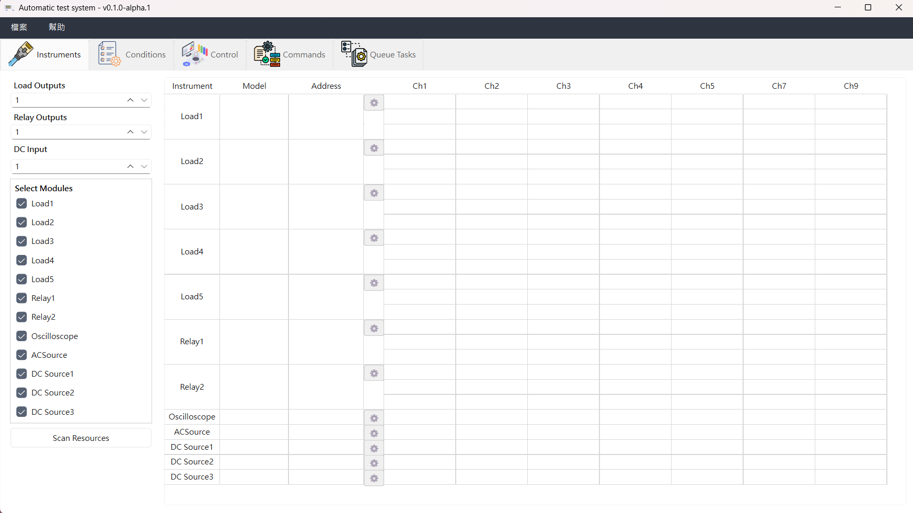
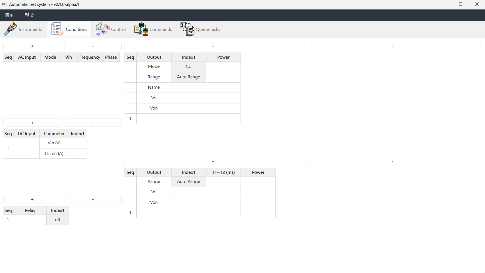
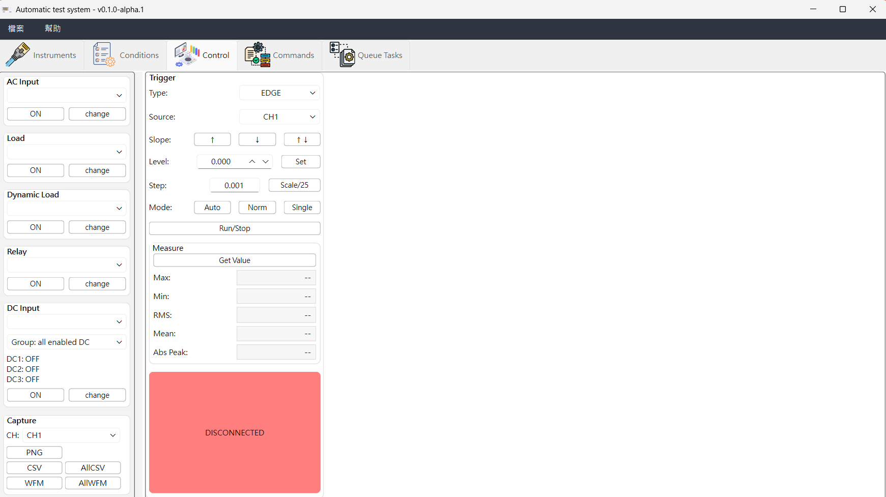
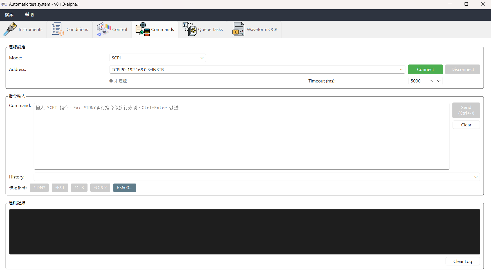
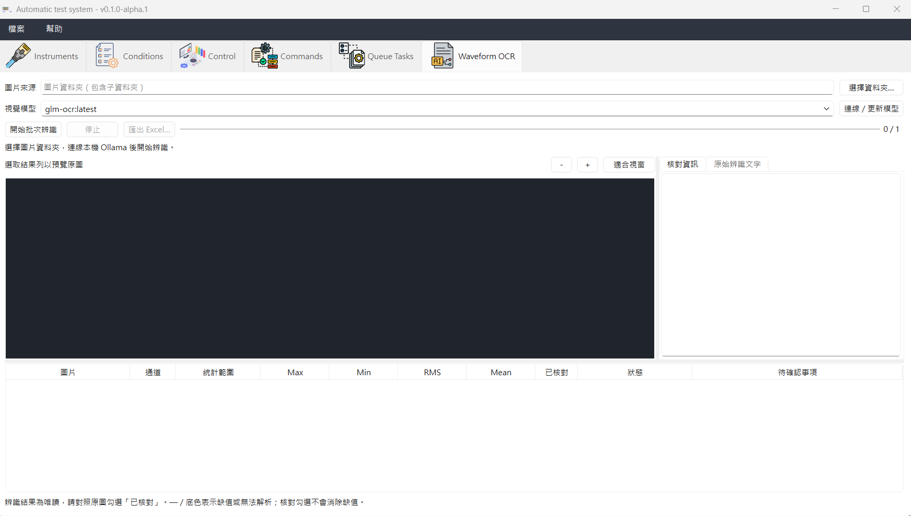

# 操作與畫面

本頁集中說明各頁功能、任務與報表、負載同步及畫面。各測試的事件順序與搜尋方式見 [Page5：量測策略](MEASUREMENT_STRATEGIES.md)，使用前請先確認 [支援儀器與限制](SUPPORTED_INSTRUMENTS.md)。

## 目前功能

**操作流程：設定儀器 → 建立條件 → 手動控制或自動測試 → 保存結果。**

| 頁面 | 主要功能 |
| --- | --- |
| Page1：儀器設定 | 設定儀器型號、通道與 GPIB／TCP/IP／Serial／Modbus RTU 通訊；Scan Resources 列出可用資源並複製地址。 |
| Page2：測試條件 | 編輯 AC／DC Input、Load、Dynamic Load 與 Relay 條件，支援新增、刪除、複製與貼上。 |
| Page3：手動控制 | 控制輸入、負載與繼電器；調整示波器觸發、讀取量測值、保存 PNG／CSV／WFM。 |
| Page4：指令工具 | 手動送出 SCPI 或 Modbus RTU 讀寫；查看通訊記錄、TX／RX Hex 與解析結果；提供 SCPI 常用指令及 63600 設定。 |
| Page5：自動測試 | 編排測試任務，支援單組／多組條件、取消、重試及 Excel 報表。 |
| Page6：Waveform OCR | 本機 Ollama 批次辨識圖片中的 Max／Min／RMS／Mean，對照原圖核對，依來源資料夾匯出 Excel。 |

Page1–5 設定可透過 XML 保存與載入，僅支援目前完整格式，不轉換舊版設定。Page6 的辨識結果與核對狀態屬於當次分析，請另匯出 Excel 保存。Scan Resources 僅列舉 VISA／COM 資源，不代表儀器已回應，也不發送控制指令。Page3 的其他儀器可在示波器未連線時獨立操作。

### 自動測試項目

- **Single／Group Test（單組／群組測試）**：Static、Dynamic、Turn on、Turn off、Short then turn on、Turn on then short；Group 依序測試多個負載條件，逐負載列出結果。Static／Dynamic 保留 Max／Min／RMS／Mean；四種暫態只保留 Max／Min。
- **Dell/HP Test**：Brown Out 降壓測試，流程見 [Page5：量測策略](MEASUREMENT_STRATEGIES.md)。
- **輔助任務**：Relay、Write Oscilloscope、Delay。
- **輸入選擇**：所有量測測試可選 AC、DC 或兩者並用；開／關事件依序操作所選輸入，並非硬體同步切換。
- **結果與報表**：結果顯示於 Tasks；新任務預設不勾選 Report，可用 Report All／Report None 一次全選或取消。勾選的任務追加至同一份 Excel，更換檔名或路徑才建立新檔。經 Excel 修改格式的報表請另用新檔名。

所有 Group 的 Tasks 結果與 Excel 都依 Page2 負載行號、名稱及通道分列量測值與狀態；Group 總列不合併不同負載的數值。四種暫態不顯示 RMS／Mean，Excel 對應欄位留空。失敗／取消保留部分資料，未執行列標示 Skipped。較長結果可在 Tasks 向下捲動查看；數值規則見 [量測值的來源](MEASUREMENT_STRATEGIES.md#page5-量測值的來源)。

## Load / Dynamic Load Sync 控制

Page1 的 `MASTER`／`SLAVE`／`NONE` 保存同步角色；編輯設定時不會直接操作硬體。Page3 手動控制與 Page5 自動測試共用 InstrumentExecutor，在執行 Load／Dynamic Load 動作時套用設定。

啟用同步時，程式先建立與檢查同步群組，再依動作暫停同步、寫入負載參數、恢復角色及切換輸出。同步成員由 Master 控制，獨立成員分別控制；63640／63600-5 的 `1,3,5,7,9` 通道各自參與群組判定。實際同步能力與時序仍須依儀器接線及型號驗證。

## 圖片展示

### Page1：儀器設定

### Page2：測試條件表格

### Page3：手動控制

### Page4：通訊指令工具

### Page5：自動測試

### Page6：Waveform OCR

[返回文件導覽](README.md#文件導覽)
