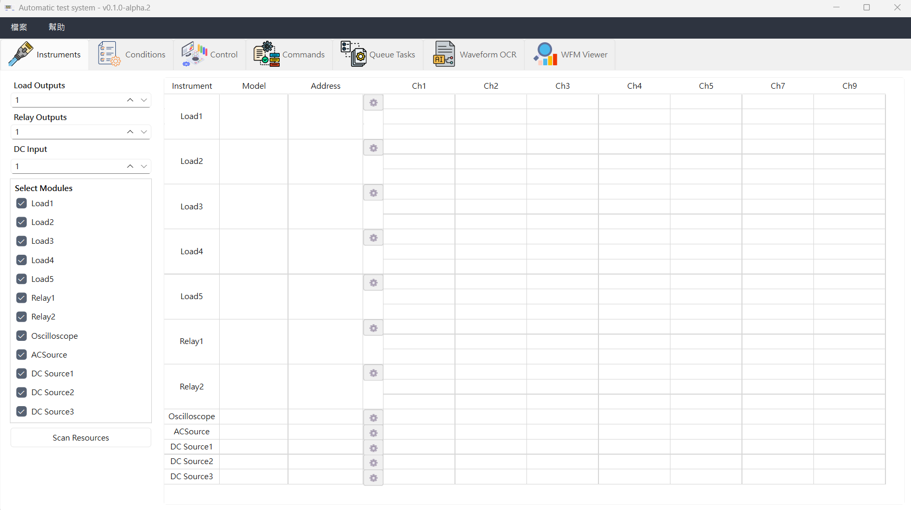
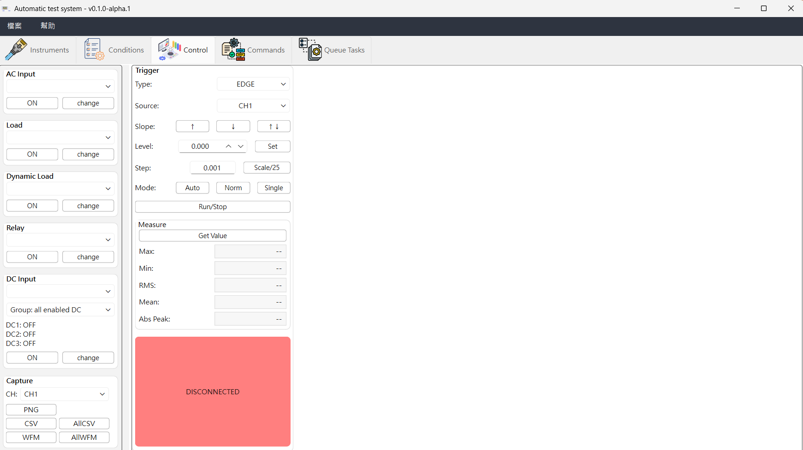
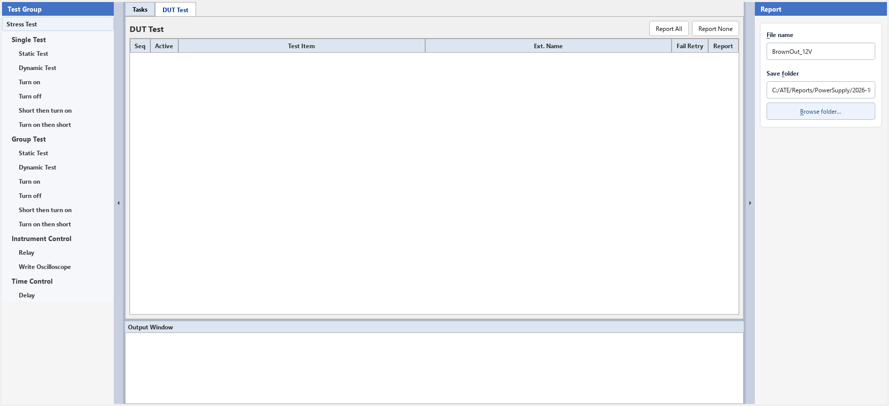
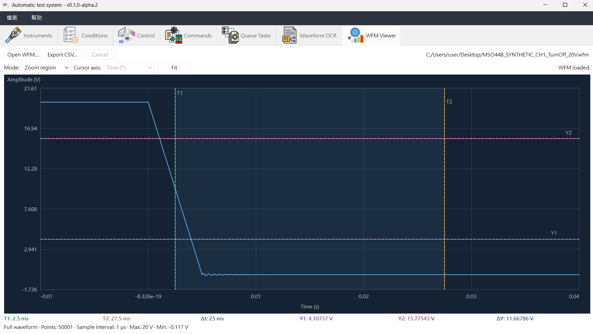

# 操作與畫面

本頁集中說明各頁功能、任務與報表、負載同步及畫面。各測試的事件順序與搜尋方式見 [TestSequence：量測策略](MEASUREMENT_STRATEGIES.md)，使用前請先確認 [支援儀器與限制](SUPPORTED_INSTRUMENTS.md)。

## 目前功能

**操作流程：設定儀器 → 建立條件 → 手動控制或自動測試 → 保存結果。**

| 頁面 | 主要功能 |
| --- | --- |
| InstrumentSetup：儀器設定 | 設定儀器型號、通道與 GPIB／TCP/IP／Serial／Modbus RTU 通訊；Scan Resources 列出可用資源並複製地址。 |
| TestConditions：測試條件 | 編輯 AC／DC Input、Load、Dynamic Load 與 Relay 條件，支援新增、刪除、複製與貼上。 |
| ManualControl：手動控制 | 控制輸入、負載與繼電器；調整示波器觸發、讀取量測值、保存 PNG／CSV／WFM。 |
| CommandConsole：指令工具 | 手動送出 SCPI 或 Modbus RTU 讀寫；查看通訊記錄、TX／RX Hex 與解析結果；提供 SCPI 常用指令及 63600 設定。 |
| TestSequence：自動測試 | 編排測試任務，支援單組／多組條件、取消、重試及 Excel 報表。 |
| WaveformOcr：Waveform OCR | 本機 Ollama 批次辨識圖片中的 Max／Min／RMS／Mean，可對照原圖修改數值，依來源資料夾匯出 Excel。 |
| WfmViewer：WFM Viewer | 開啟 Tektronix 類比 WFM、區域縮放、時間／振幅游標及完整原始波形 CSV 匯出。 |

InstrumentSetup／TestConditions／ManualControl／CommandConsole／TestSequence 設定可透過 XML 保存與載入，僅支援目前完整格式，不轉換舊版設定。WaveformOcr 的辨識結果與核對狀態屬於當次分析，請另匯出 Excel 保存。正常關閉時若有未匯出變更，會提供匯出／放棄／取消；取消或匯出失敗保留資料。Scan Resources 僅列舉 VISA／COM 資源，不代表儀器已回應，也不發送控制指令。ManualControl 的其他儀器可在示波器未連線時獨立操作。

TestSequence 尚未設定的任務可作草稿保存，包括新加入的 Write Oscilloscope。XML 載入失敗時保留原有任務與報表設定；草稿在 Run 前仍須通過完整設定檢查。

各任務 Dialog 的 Apply 保存設定；Close／Escape 放棄本次修改。Capture settings 至少勾選一種格式，未指定格式時預設 WFM＋PNG。

WaveformOcr 完成或停止辨識後，可雙擊 Max／Min／RMS／Mean、按 F2，或按「修改數值」編輯，Enter 儲存、Esc 取消。可輸入含單位的數值（如 `5.1 V`、`-185.3 mA`）；只改數字時會沿用該欄位原有單位，或該列唯一的有效單位。沒有可用單位時請一併輸入單位。清空欄位表示缺值，格式錯誤以黃色底色提示。通道、統計範圍及「已核對」皆為選填，不影響匯出；需要時可勾選「顯示通道／統計範圍」修改。Excel 匯出採用修改後的數值，並保留原始辨識文字、辨識原值及手動修改標記。

### 儀器通訊設定

按儀器的設定按鈕選擇通訊方式，OK 提交，Cancel／Escape 放棄本次修改。

| 通訊方式 | 設定方式 |
| --- | --- |
| TCP/IP (VXI-11) | 填儀器 IP；Port 由 VISA 處理，畫面不顯示 Socket Port 或埠號提示。資源範例：`TCPIP0::192.168.1.100::INSTR`。 |
| TCP/IP (Socket) | 填 IP 與儀器指定的 Port。資源範例：`TCPIP0::192.168.1.100::5025::SOCKET`。切換回 VXI-11 再返回時保留已輸入 Port。 |
| Serial (RS-232/RS-485) | 設定 COM、Baud、Data bits、Parity、Stop bits 及 Flow control。 |
| Modbus RTU | 與 Serial 共用串口欄位，使用 8 data bits、Slave ID 1–247，無 Flow control。切回 Serial 保留原本 Data bits／Flow control 草稿。 |

RTU 的「測試連線」只開啟並關閉串口，不發送 SCPI 或 Modbus 命令；「串口已開啟，未驗證設備回應」不代表從站通訊成功。其他原有連線測試維持既有查詢行為。XML 保留所選協議與適用參數；無效的舊 RTU Data bits／Slave ID 會保留供修正，不能直接 OK。

### WFM Viewer

按 **Open WFM…** 開啟 Tektronix WFM v3 的單筆類比 YT 波形。支援 Sample 與 Peak Detect 的 Min/Max 成對記錄，時間與取樣間隔由檔頭自動解析，不限定 Time/div 或取樣率。最多 1,000 萬儲存數值（Min/Max 為 500 萬組）、512 MiB 檔案；FastFrame、summary frame、digital、IQ、histogram、XY、roll 及舊版格式會明確提示不支援。

使用 **Cursor／Pan／Zoom** 三個互斥按鈕選擇操作，預設 **Zoom**：拖曳方框，放大選取的時間與振幅區域；**Pan** 拖曳平移；**Cursor** 直接拖曳 T1／T2 垂直時間線或 Y1／Y2 水平振幅線，不須切換軸。靠近交點拖曳可同時移動一條時間線與一條振幅線；距離線超過 8 個畫面邏輯像素時不會跳動游標，同軸重合時優先選 1。滾輪向上放大、向下縮小指標所在區域，**Fit** 或雙擊恢復全貌。

檔案路徑在頂列右側，可選取複製；過長時可用方向鍵水平瀏覽，滑鼠停留顯示完整路徑。狀態放在操作列右側，滑鼠停留在波形或目前模式按鈕可查看操作提示。

下方精簡顯示 **T1、T2、Δt = |T2 − T1|** 與 **Y1、Y2、ΔY = |Y2 − Y1|**，寬度不足時自動換列；Y 使用波形原單位（V／A 等），T 依數值自動使用 s／ms／µs／ns／ps；滑鼠停留可看完整精度。游標可交錯，不吸附取樣點。縮放與 Fit／雙擊保留四條游標的時間／振幅；游標超出視窗會顯示 outside view，按 Fit 回到全貌後可重新拖曳。新檔案以有效時間及完整振幅顯示範圍（含 padding）的 25%／75% 初始化。最下方 **Full waveform** 摘要只顯示完整原始波形的點數、取樣間隔及 Max／Min，不隨縮放或游標改變；本頁不顯示 Mean／RMS，也沒有游標區間統計。

Peak Detect 預設只畫每組 Min–Max 垂直範圍線；勾選 **上下界連線** 才另將相鄰組的 Max 接 Max、Min 接 Min，形成上下包絡線。相等上下限顯示為點；縮小時保留每個顯示區間的極值。成功載入新檔會重設為不連線，載入失敗或取消則保留原選擇；此選項在一般 Sample 或處理中停用。摘要列出組數與區間間隔。連線只供顯示插值，同組 Min／Max 的實際先後時間未包含在檔案中，游標讀值代表座標位置；一般 Sample 維持相鄰取樣點的折線。

**Export CSV…** 匯出完整原始波形；Sample 為 Time／Value，Min/Max 為每組一列 Time／Min／Max，時間為區間起點，不受縮放範圍或游標影響，也不改寫 WFM。載入／匯出期間可 **Cancel**；錯誤或取消保留上一筆有效波形、視窗與游標。匯出完成後的取消不回溯已保存檔案。工作階段不存入設備 XML，關閉後須重新載入。此版不提供預處理；後續功能依需求另行增加。

### 自動測試項目

Static／Dynamic／Turn on／Turn off／Short then turn on／Turn on then short（含 Group）可在 Dialog 選 **Trigger source**，按 Apply 保存。每次測試、Group 成員及重試開始前先設定並確認所選來源，再上電／量測；該通道須事先啟用，量測仍涵蓋已啟用通道。新測項預設 CH1；舊設定缺少此欄位時顯示 **Keep current source**，保留示波器原來源，選擇 CH 後才改變。

- **Single／Group Test（單組／群組測試）**：Static、Dynamic、Turn on、Turn off、Short then turn on、Turn on then short；Group 依序測試多個負載條件，逐負載列出結果。每筆有效 Trial 均保存 Max／Min／RMS／Mean，並分 Rise／Fall 選出完整四值代表結果。
- Turn on／Short then turn on／Turn on then short（含 Group）每次事件 Single 成功後等待 **3000 ms**，再走原 READY／Baseline 檢查；提前觸發後重新 Single 也等待。Stop 可中斷，時間計入 Phase time limit；原 Level 避讓、短路退出及 Rise／Fall 保留，AUTO 參考不加等待。
- **Descent 單組測試**：Turn off (descent)、Turn on then short (descent)。Trigger CH 選負緣觸發 Channel，量測沿用已啟用的示波器通道。Turn off (descent) 另有 **Enable**（預設勾選），只控制觸發 CH 的顯示／量測，未勾選仍使用該 CH 觸發；其他 CH 不變。若關閉觸發 CH，WFM／CSV Capture 須另選已啟用 CH，PNG 不受此限制。Trigger levels 可新增、刪除與編輯，依列順序執行；每次重新上電後觸發，依序保存四值與 Level。原有 Rise／Fall 追蹤保持不變，詳細流程見 [量測策略](MEASUREMENT_STRATEGIES.md)。
- Turn off (descent) 上電穩定後自動檢查啟用通道，截波則將該通道 V/div ×2 並重新擷取；正式事件仍截波時重做同一組 Level／Trial，結束後還原自動調整的刻度。原固定 Trigger source／Level 保留，重試受次數與 Phase time limit 限制。
- 兩種 descent 每個 Level／Trial 的正式事件 Single 後固定等待 **3000 ms**，再確認 READY 才關電或短路；Stop 可中斷，等待計入 Phase time limit。AUTO 預檢不加此等待。Turn off (descent) 若確認在關機前已觸發且自然完成，該筆 Fail，清理與診斷保存成功後跳過同 Level 剩餘 Trials，接著測下一列 Level；整體仍 Fail。未確認完成、通訊、逾時、Stop 或清理失敗均中止，short descent 保持原流程。
- Turn off (descent) 的 Detail 預設 **Trials**，逐筆列出 Level／Trial 與完整四值；可切回 Summary。Fail／Skipped 列保留原因，沒有有效事件的四值為 NA；Excel Trials 同樣保留每筆，Results 保留代表值及失敗／略過記錄。
- Brown Out 初次事件 Single／RUN 後等待 **3000 ms** 再確認 READY；Track＋Capture 每次重新 Single 也等待後才恢復降壓。等待可 Stop，Vout 監測持續；未開 Capture 的連續 RUN 後續 Level 更新不增加等待。
- **Dell/HP Test**：Brown Out 降壓測試，流程見 [TestSequence：量測策略](MEASUREMENT_STRATEGIES.md)。
- **輔助任務**：Relay、Write Oscilloscope、Delay。
- **輸入選擇**：所有量測測試可選 AC、DC 或兩者並用；開／關事件依序操作所選輸入，並非硬體同步切換。
- **結果與報表**：結果顯示於 Tasks；新任務預設不勾選 Report，可用 Report All／Report None 一次全選或取消。勾選的任務追加至同一份 Excel，更換檔名或路徑才建立新檔。經 Excel 修改格式的報表請另用新檔名。

Tasks 顯示摘要；選取一項 Task 後，在下方 **Detail** 切換 Summary／Trials，並篩選 Attempt、Load、Direction、CH。Single 顯示實際負載條件，Group 依 TestConditions 行號及名稱分列。Rise 選 Max 最高那筆，Fall 選 Min 最低那筆，四值整組保留；Excel 的 **Results／Trials** 分別保存代表值與逐次資料。未選方向為 Not run，沒有有效值為 NA，重試各自保存。舊版單表報表請另用新檔名。

原 **Turn off／Turn on then short（均含 Group）** 若某方向正常搜尋完成卻沒有暫態觸發，Detail 與 Excel 兩表改顯示該方向的穩態參考四值，Note／提示標示 `Steady reference (no transient trigger)`。有暫態事件時仍優先使用事件結果；穩態參考不計入 Trial 次數。

### 垂直餘量選項

Static／Dynamic／Turn on／Turn off／Short then turn on／Turn on then short（含 Group）可勾選 **Vertical margin (10% top/bottom)**，預設關閉。開啟後若波形超出畫面中央 80%，一般波形會置中；直線正值靠近上方 10% 邊界、負值靠近下方，零附近置中。Scale 只擴大，Offset 保留；波形已符合餘量就不移動。真正截波仍以 Scale ×2 重試。測項結束後還原自動改過的 Scale／Position，還原失敗會停止後續測試。

### Write Oscilloscope 設定

Channels 與 Trigger Source 依 InstrumentSetup 型號顯示 4／6／8 個通道。每區的 Ignore 表示執行時略過該區；Scale 的 Custom 可輸入 V／mV／uV 或 A／mA／uA，BW 可選 Full、預設頻寬或輸入自訂頻率。啟用通道的 Scale／BW 無效時，須修正後才能 Apply。

Mode 選擇 **Auto／Manual**。Manual 的 Inputs 可選 **Time Scale + Sample Rate** 或 **Sample Rate + RL**，數字與單位分開，支援鍵盤輸入；第三值依 10 格自動計算。可先改任一輸入，切換 Inputs 時沿用目前計算值。Position 預設 40%。

| Inputs | 範例 | 計算值 |
| --- | --- | --- |
| Time Scale + Sample Rate | 16 us/div、1.25 GS/s | RL ≈ 200k points |
| Time Scale + Sample Rate | 100 us/div、625 MS/s | RL ≈ 625k points |
| Sample Rate + RL | 625 MS/s、625k points | Time Scale ≈ 100 us/div |

**Range check** 依實際設備選擇 MSO44B 標準 31.25M、已安裝的 62.5M 選配，或 Other。MSO44B profile 檢查即時取樣率 1.5625 S/s～6.25 GS/s、RL 最少 1k 及所選容量；Other 保留數值檢查，實際能力由儀器判定。此選項是人工選擇的檢查範圍，並非自動偵測。快捷選單不是官方完整刻度表。

Apply 只保存設定；任務執行時設定兩個獨立值，再讀回實際 Time Scale、Sample Rate、RL 與格數。**Log** 列出 requested／actual；儀器調整時明確標示 adjusted，預覽不視為實際讀回。

## Load / Dynamic Load Sync 控制

InstrumentSetup 的 `MASTER`／`SLAVE`／`NONE` 保存同步角色；編輯設定時不會直接操作硬體。ManualControl 手動控制與 TestSequence 自動測試共用 InstrumentExecutor，在執行 Load／Dynamic Load 動作時套用設定。

啟用同步時，程式先建立與檢查同步群組，再依動作暫停同步、寫入負載參數、恢復角色及切換輸出。同步成員由 Master 控制，獨立成員分別控制；63640／63600-5 的 `1,3,5,7,9` 通道各自參與群組判定。實際同步能力與時序仍須依儀器接線及型號驗證。

## 圖片展示

### InstrumentSetup：儀器設定

### TestConditions：測試條件表格

### ManualControl：手動控制

### CommandConsole：通訊指令工具

### TestSequence：自動測試

### WaveformOcr：Waveform OCR

### WfmViewer：WFM Viewer

下圖為前版畫面參考；現行操作改用 **Cursor／Pan／Zoom** 按鈕，Peak Detect 可選 **上下界連線**，游標可直接拖曳兩軸。操作方式以本頁 [WFM Viewer 說明](#wfm-viewer) 為準。

[返回文件導覽](README.md#文件導覽)
